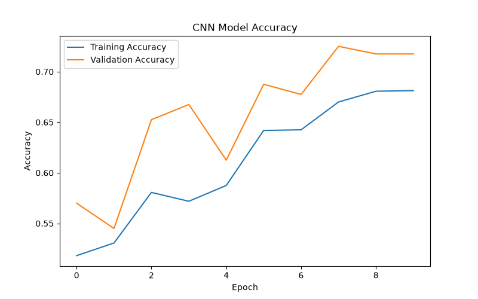
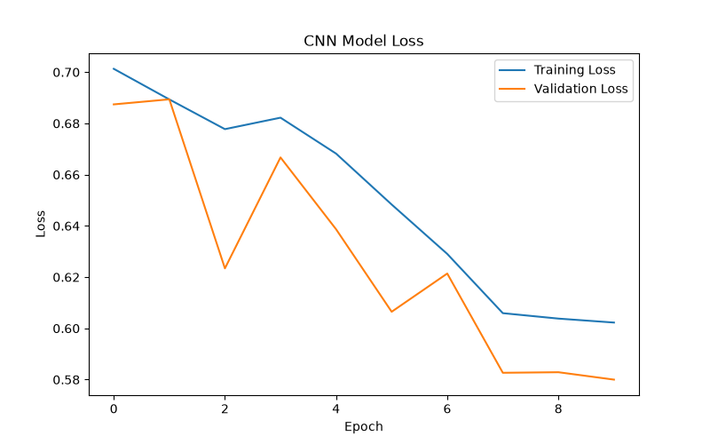

# Cat vs Dog Image Recognition using CNN

## About Project
This is my CNN project. I made this project to identify cats and dogs from images. I trained the model using different cat and dog images.

## Technologies Used
- Python
- TensorFlow
- Keras
- NumPy
- Matplotlib

## Dataset
I used cat and dog images for training, validation and testing.

- Training: 800 Cats + 800 Dogs
- Validation: 200 Cats + 200 Dogs
- Testing: 100 Cats + 100 Dogs

## Model
CNN (Convolutional Neural Network)

## Test Result
- Accuracy: 70%
- Loss: 0.5609

## Graphs

### Accuracy Graph

### Loss Graph

## Project Files
- `cat_dog_image_reco.py` – Dataset preparation
- `train_model.py` – Model training
- `predict_image.py` – Image prediction

## How to Run
1. Install the required libraries.
2. Run `train_model.py`.
3. Run `predict_image.py` and give an image to check the result.

## Author
Priyal